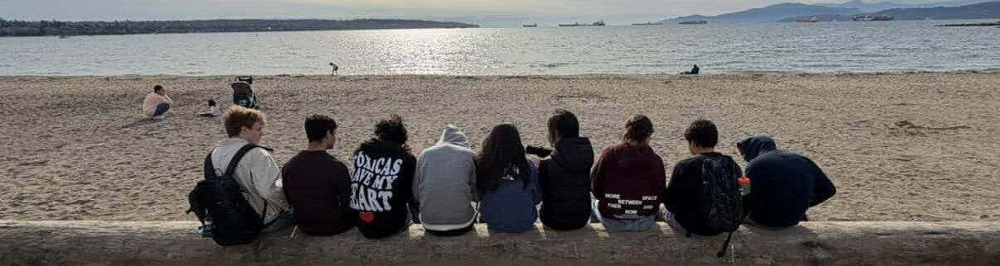

<!-- PLACEHOLDER DA LOGO: troque o src abaixo pelo caminho da sua logo (ex.: .docs/.assets/logo.png) -->

### Viaje pelo continente. _Conte como foi._

**Avaliações e comentários locais sobre os lugares por onde você já viajou.**

  

## ✈️ Sobre o projeto

O **Pan-American Highway** é um site de avaliações e comentários locais, desenvolvido como trabalho de faculdade. Depois de se cadastrar, o usuário registra os destinos que já visitou e compartilha sua opinião sobre cada um deles. A aplicação usa HTML, CSS e JavaScript no site e a API web-data-viz para guardar os dados em um banco MySQL.

O projeto nasceu com **3 objetivos**:

|     | Objetivo                  | Descrição                                                          |
| :-: | ------------------------- | ------------------------------------------------------------------ |
|  ⚑  | **Registro de destinos**  | Guardar os lugares visitados, com país, cidade e tempo de estadia. |
|  ★  | **Avaliação dos lugares** | Dar a cada destino uma nota de 0 a 5.                              |
|  ✎  | **Armazenar comentários** | Guardar memórias importantos dos lugares visitados.                |

## 🔗 Links

| Documento    | Link                             |
| ------------ | -------------------------------- |
| Documentação | [Word](COLE_AQUI_O_LINK_DO_WORD) |

 

_Toda estrada tem uma história para contar._

